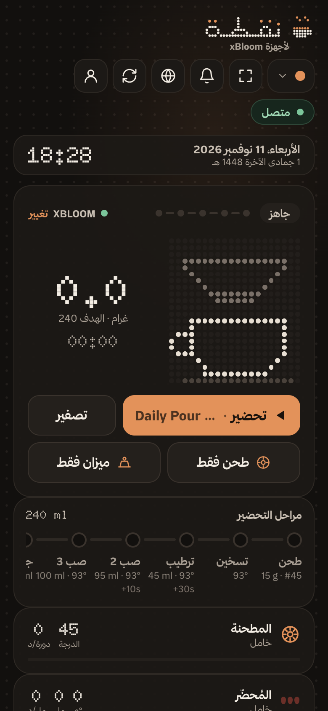

<p align="center">
  
  &nbsp;
  
</p>

<h1 align="center">نُقطة · Nuqta</h1>
<p align="center"><b>A dot‑matrix dashboard that controls your xBloom coffee machine</b><br>
Arabic first · tablet, iPad, phone and desktop · themes · Saudi standby scenes · runs at home, free</p>

<p align="center">
  <a href="#install">Install</a> ·
  <a href="#install-with-claude-code-no-technical-steps">Install with Claude Code</a> ·
  <a href="https://hub.nuqtasa.tools/install">دليل التثبيت بالعربية</a> ·
  <a href="#nuqta-cloud-optional">Nuqta Cloud</a> ·
  <a href="#troubleshooting">Troubleshooting</a>
</p>

---

Nuqta turns a spare tablet, phone or screen into a controller for an **xBloom** coffee machine. A
computer near the machine (Mac, Windows or Linux) talks to it over Bluetooth and serves a live
dashboard to every screen on your home Wi‑Fi. It's free and open source, and everything runs on your
own computer — no account needed.

> Unofficial and not affiliated with xBloom. It uses a reverse‑engineered Bluetooth interface that
> may change at any time.

<p align="center"></p>

## What it does
- **One‑tap brew** of any recipe, with pause, resume and stop.
- **Live dot‑matrix animation** for every stage — grinding, heating, each pour, the cup filling.
- **Brew timeline** showing each step's amount, temperature and wait.
- **Modes:** grind only, water only (temperature · amount · pour pattern), and scale only.
- **Water tank** card that tracks the level and warns when it's low.
- **Recipes and schedules** — wake up to a fresh cup.
- **Customisable home** per device, **themes** that recolour everything, **standby** scenes.
- **Arabic and English**, with Gregorian and Hijri dates.
- **Alexa (optional):** "Alexa, turn on coffee".

<p align="center">
  
  &nbsp;
  
</p>

## Install

### What you need
- A **computer with Bluetooth** that stays near the xBloom: **macOS**, **Windows 10 (1809+)**, or
  **Linux**. macOS is the best‑tested; Windows and Linux are supported but newer.
- **Python 3.10 or newer** — [python.org/downloads](https://www.python.org/downloads/)
  (on Windows, tick **"Add python.exe to PATH"** during setup).
- **Node.js 18 or newer** (the LTS version) — [nodejs.org](https://nodejs.org).
- Your **xBloom** turned on.

### 1. Download
```bash
git clone https://github.com/JustMuath1/nuqta-app.git
```
```bash
cd nuqta-app
```
No Git? Use **Code → Download ZIP** on this page and unzip it.

### 2. Run the installer
It creates a private Python environment inside the folder, installs everything, builds the dashboard
and starts Nuqta. Nothing is installed system‑wide.

| Your computer | Do this |
|---|---|
| **macOS** | Double‑click **`install.command`** (or run `zsh install.command` in Terminal) |
| **Windows** | Double‑click **`install.bat`** |
| **Linux** | Run `bash install.sh` |

> **macOS says the file "can't be opened"?** That happens with the ZIP download. Right‑click
> `install.command` → **Open** → **Open**, or run `zsh install.command` in Terminal.

### 3. Open the dashboard
- On the first start, **macOS asks for Bluetooth permission — click Allow.**
- On the same computer open **http://localhost:8420**.
- On a phone or tablet on the same Wi‑Fi, open the **`http://<your-computer's-IP>:8420`** address the
  window prints. In Safari, **Share → Add to Home Screen** makes it look like an app.
- Turn the xBloom on — it connects by itself.

**Starting it next time:** `start-nuqta.command` (macOS), `start-nuqta.bat` (Windows), or
`./start-nuqta.sh` (Linux). Keep that window open while you use Nuqta.

## Install with Claude Code (no technical steps)
[Claude Code](https://code.claude.com/docs/en/overview) can do the whole install for you: it
downloads Nuqta, checks what's missing, runs the installer and starts it, explaining each step.
You need a **paid Claude plan (Pro or higher)** — the free plan doesn't include Claude Code.

### Option A — Claude desktop app (no terminal)
1. Download the **Claude** app from [claude.com/download](https://claude.com/download) and sign in.
2. Open the **Code** tab, then choose a folder for Nuqta to live in (for example *Documents*):
   click the folder control under the prompt box → **Open folder…**.
3. Paste this and press Enter:
   > **Download Nuqta from https://github.com/JustMuath1/nuqta-app and set it up for my xBloom.**

   بالعربي:
   > **حمّل نقطة من https://github.com/JustMuath1/nuqta-app وجهّزها لآلة xBloom عندي.**

### Option B — Claude Code in the terminal
1. Install Claude Code:

   | Your computer | Run this |
   |---|---|
   | **macOS / Linux** | `curl -fsSL https://claude.ai/install.sh \| bash` |
   | **Windows** (PowerShell) | `irm https://claude.ai/install.ps1 \| iex` |

   Then open a **new** terminal window. (Homebrew: `brew install --cask claude-code` ·
   WinGet: `winget install Anthropic.ClaudeCode`.)
2. Go to a folder for Nuqta and start Claude:
   ```bash
   cd ~/Documents
   ```
   ```bash
   claude
   ```
   The first time, it opens your browser to sign in.
3. Paste the same message as in Option A.

### What happens next
- Claude checks for **Python** and **Node.js**. If one is missing it tells you exactly what to
  install, then carries on.
- It asks your permission before running commands — read each one and approve it.
- It runs the installer and opens Nuqta in its own window. **On a Mac, click Allow when macOS asks
  for Bluetooth.**
- It gives you the address to open on your phone.

**Later, just ask Claude** in the same folder: *"update Nuqta"*, *"my phone can't open the
dashboard"*, *"add my xBloom recipes"*, or *"start Nuqta"*. It follows the instructions in
[`CLAUDE.md`](CLAUDE.md).

## Optional extras
- **Your own xBloom recipes:** copy `xbloom_config.example.json` to `xbloom_config.json` and add your
  xBloom email and password. The file stays on your computer (it's git‑ignored). Without it, a few
  starter recipes are built in.
- **Fonts:** the UI prefers the licensed **Thmanyah** font and falls back to IBM Plex Sans Arabic.
  To use Thmanyah, put its `.woff2`/`.otf` files in a `fonts/` folder.

## Nuqta Cloud (optional)
The app is complete and free on your home Wi‑Fi. **Nuqta Cloud** adds what needs a server:
- Open your dashboard **from your phone away from home** — no router setup.
- **"Your coffee is ready"** alerts on your phone, with sound.
- **Sync and backup** of your settings and brew history.
- **Automatic updates**, security fixes included.

**49 SAR, paid once, for life** — no monthly subscription.
**Join at [hub.nuqtasa.tools](https://hub.nuqtasa.tools)**, then in the app go to
**Settings → Nuqta Cloud**, enter the same email and the 6‑digit code you receive.

## Updating
Double‑click **`nuqta-update.command`** (macOS). It downloads the latest version, updates packages,
rebuilds and restarts — your recipes, settings and history are kept. On Windows or Linux:
```bash
git pull
```
then run the installer again. With Claude Code, just say **"update Nuqta"**.

## Troubleshooting
- **"Disconnected" / can't find the machine:** keep the computer within Bluetooth range and the
  xBloom on. On macOS, check **System Settings → Privacy & Security → Bluetooth** allows Terminal.
  On Linux, make sure Bluetooth is on (`sudo systemctl enable --now bluetooth`).
- **Phone can't open the address:** it must be on the same Wi‑Fi as the computer, and the computer's
  firewall must allow incoming connections for Python.
- **"Port 8420 in use":** the start scripts stop an old Nuqta first; if it persists, restart the
  computer or close the other program using that port.
- **Installer says Python or Node is missing:** install them from the links above, then run the
  installer again.
- **Something else:** [open an issue](https://github.com/JustMuath1/nuqta-app/issues) with what you
  see in the Nuqta window.

## Privacy
Everything runs on your computer. Nuqta only talks to the internet to sync recipes from your xBloom
account (if you add it) and, if you sign in to Nuqta Cloud, to `hub.nuqtasa.tools`.

## License
MIT — see [LICENSE](LICENSE). Not affiliated with xBloom; "xBloom" is a trademark of its owner.
