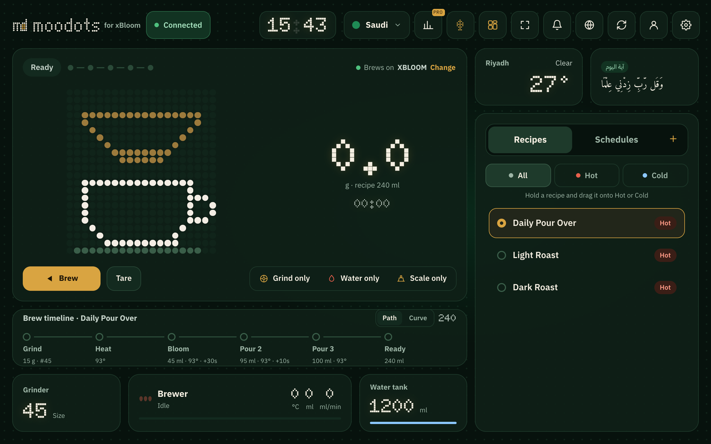
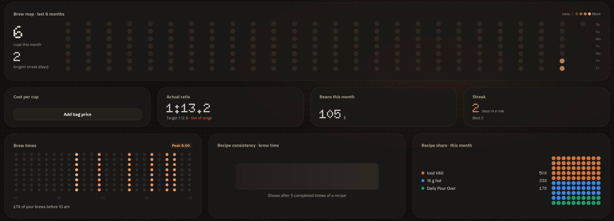

<p align="center">
  <picture>
    <source media="(prefers-color-scheme: light)" srcset="docs/brand/moodots-md-light.svg">
    
  </picture>
  &nbsp;&nbsp;
  <picture>
    <source media="(prefers-color-scheme: light)" srcset="docs/brand/moodots-wordmark-en-light.svg">
    
  </picture>
</p>

<h1 align="center">مودوتس · moodots</h1>
<p align="center"><b>A dot‑matrix dashboard that controls your xBloom coffee machine</b><br>
Arabic first · tablet, iPad, phone and desktop · themes · Saudi standby scenes · runs at home, free</p>

<p align="center">
  <a href="#install">Install</a> ·
  <a href="#install-with-claude-code-no-technical-steps">Install with Claude Code</a> ·
  <a href="#raspberry-pi--an-alwayson-host-no-mac-needed">Raspberry Pi</a> ·
  <a href="https://hub.nuqtasa.tools/install">دليل التثبيت بالعربية</a> ·
  <a href="#moodots-pro">moodots Pro</a> ·
  <a href="#troubleshooting">Troubleshooting</a>
</p>

---

moodots turns a spare tablet, phone or screen into a controller for an **xBloom** coffee machine. A
computer near the machine (Mac, Windows or Linux) talks to it over Bluetooth and serves a live
dashboard to every screen on your home Wi‑Fi. It's free and open source, and everything runs on your
own computer — no account needed.

> Unofficial and not affiliated with xBloom. It uses a reverse‑engineered Bluetooth interface that
> may change at any time.

<p align="center"></p>

## What it does
- **One‑tap brew** of any recipe, with pause, resume and stop.
- **Live dot‑matrix animation** for every stage — grinding, heating, each pour, the cup filling.
- **Brew timeline** showing each step's amount, temperature and wait.
- **Modes:** grind only, water only (temperature · amount · pour pattern), and scale only.
- **Water tank** card that tracks the level and warns when it's low.
- **Recipes and schedules** — wake up to a fresh cup.
- **Customisable home** per device, **4 themes** that recolour everything, **3 standby** scenes —
  more with [moodots Pro](#moodots-pro).
- **Arabic and English**, with Gregorian and Hijri dates.
- **Alexa (optional):** "Alexa, turn on coffee" — see [Voice control](#voice-control-alexa).

<p align="center">
  
  &nbsp;
  
</p>

## Install

### What you need
- A **computer with Bluetooth** that stays near the xBloom: **macOS**, **Windows 10 (1809+)**, or
  **Linux**. macOS is the best‑tested; Windows and Linux are supported but newer.
- **Python 3.10 or newer** — [python.org/downloads](https://www.python.org/downloads/)
  (on Windows, tick **"Add python.exe to PATH"** during setup).
- **Node.js 20.19 or newer** (the LTS version) — [nodejs.org](https://nodejs.org). moodots runs on
  Node 18, but voice control needs 20.19 or newer.
- Your **xBloom** turned on.

### 1. Download
```bash
git clone https://github.com/JustMuath1/moodots-app.git
```
```bash
cd moodots-app
```
No Git? Use **Code → Download ZIP** on this page and unzip it.

### 2. Run the installer
It creates a private Python environment inside the folder, installs everything, builds the dashboard
and starts moodots. Nothing is installed system‑wide.

| Your computer | Do this |
|---|---|
| **macOS** | Double‑click **`install.command`** (or in Terminal: `cd` into the folder, then `zsh install.command`) |
| **Windows** | Double‑click **`install.bat`** |
| **Linux** | Run `bash install.sh` |

> The folder is **`moodots-app-master`** (in Downloads) if you used the ZIP, or **`moodots-app`** if you used Git.
> In Terminal, type `cd ` (with a space) and drag the folder into the window to go there.

> **macOS says the file "can't be opened"?** That happens with the ZIP download. Right‑click
> `install.command` → **Open** → **Open**, or run `zsh install.command` in Terminal from that folder.

### 3. Open the dashboard
- On the first start, **macOS asks for Bluetooth permission — click Allow.**
- On the same computer open **http://localhost:8420**.
- On a phone or tablet on the same Wi‑Fi, open the **`http://<your-computer's-IP>:8420`** address the
  window prints. In Safari, **Share → Add to Home Screen** makes it look like an app.
- Turn the xBloom on — it connects by itself.

**Starting it next time:** `start-moodots.command` (macOS), `start-moodots.bat` (Windows), or
`./start-moodots.sh` (Linux). Keep that window open while you use moodots.

## Raspberry Pi — an always‑on host, no Mac needed
A **Raspberry Pi** placed near the xBloom can run moodots 24/7 on very little power. Your tablets and
phones (Android included) open the dashboard from it. An Android tablet can't be the host itself:
Android doesn't let ordinary apps use the Bluetooth access moodots needs — but it works fully as a
screen.

### What you need
- **Raspberry Pi 4 or 5** (2 GB RAM or more) — they have Bluetooth and Wi‑Fi built in. A Pi 3B+ or
  Zero 2 W also has Bluetooth but builds slowly.
- Its power supply and a **microSD card** (16 GB+).
- A computer to prepare the card.

### 1. Prepare the card
1. Install **[Raspberry Pi Imager](https://www.raspberrypi.com/software/)** on your computer.
2. Choose your Pi model, **Raspberry Pi OS (64‑bit)** (Lite is enough), and the microSD card.
3. When it asks to customise settings, set:
   - hostname **`moodots`**
   - a username and password
   - your **Wi‑Fi** name and password
   - under Services, **enable SSH**
4. Write the card, put it in the Pi, power it on near the xBloom and wait about 2 minutes.

### 2. Connect to it
From your computer's Terminal (Windows: PowerShell), using the username you chose:
```bash
ssh <username>@moodots.local
```

### 3. Install moodots on the Pi
The current Raspberry Pi OS (13 Trixie) installs a Node new enough for voice control; the older one
(12 Bookworm) runs moodots without voice control.
```bash
sudo apt update && sudo apt install -y git python3-venv nodejs npm bluez lsof
```
```bash
git clone https://github.com/JustMuath1/moodots-app.git && cd moodots-app
```
```bash
MOODOTS_NO_START=1 bash install.sh
```
Building the dashboard can take a couple of minutes on a Pi.

### 4. Start it automatically at every boot
```bash
bash install-service.sh
```
It prints the address to open — usually **http://moodots.local:8420**. On Android, open it in
Chrome → menu → **Add to Home screen**. (If `moodots.local` doesn't open on Android, use the IP
address it printed.)

**Day to day:** restart with `sudo systemctl restart moodots`, watch the log with
`journalctl -u moodots -f`. **Update:** `cd moodots-app && git pull && MOODOTS_NO_START=1 bash
install.sh && sudo systemctl restart moodots`. **Turn off auto‑start:** `bash install-service.sh
--remove`.

## Install with Claude Code (no technical steps)
[Claude Code](https://code.claude.com/docs/en/overview) can do the whole install for you: it
downloads moodots, checks what's missing, runs the installer and starts it, explaining each step.
You need a **paid Claude plan (Pro or higher)** — the free plan doesn't include Claude Code.

### Option A — Claude desktop app (no terminal)
1. Download the **Claude** app from [claude.com/download](https://claude.com/download) and sign in.
2. Open the **Code** tab, then choose a folder for moodots to live in (for example *Documents*):
   click the folder control under the prompt box → **Open folder…**.
3. Paste this and press Enter:
   > **Download moodots from https://github.com/JustMuath1/moodots-app and set it up for my xBloom.**

   بالعربي:
   > **حمّل مودوتس من https://github.com/JustMuath1/moodots-app وجهّزه لآلة xBloom عندي.**

### Option B — Claude Code in the terminal
1. Install Claude Code:

   | Your computer | Run this |
   |---|---|
   | **macOS / Linux** | `curl -fsSL https://claude.ai/install.sh \| bash` |
   | **Windows** (PowerShell) | `irm https://claude.ai/install.ps1 \| iex` |

   Then open a **new** terminal window. (Homebrew: `brew install --cask claude-code` ·
   WinGet: `winget install Anthropic.ClaudeCode`.)
2. Go to a folder for moodots and start Claude:
   ```bash
   cd ~/Documents
   ```
   ```bash
   claude
   ```
   The first time, it opens your browser to sign in.
3. Paste the same message as in Option A.

### What happens next
- Claude checks for **Python** and **Node.js**. If one is missing it tells you exactly what to
  install, then carries on.
- It asks your permission before running commands — read each one and approve it.
- It runs the installer and opens moodots in its own window. **On a Mac, click Allow when macOS asks
  for Bluetooth.**
- It gives you the address to open on your phone.

**Later, just ask Claude** in the same folder: *"update moodots"*, *"my phone can't open the
dashboard"*, *"add my xBloom recipes"*, or *"start moodots"*. It follows the instructions in
[`CLAUDE.md`](CLAUDE.md).

## Optional extras
- **Your own xBloom recipes:** copy `xbloom_config.example.json` to `xbloom_config.json` and add your
  xBloom email and password. The file stays on your computer (it's git‑ignored). Without it, a few
  starter recipes are built in.
- **Fonts:** the UI prefers the licensed **Thmanyah** font and falls back to IBM Plex Sans Arabic.
  To use Thmanyah, put its `.woff2`/`.otf` files in a `fonts/` folder.

## Voice control (Alexa)
moodots shows up in the Alexa app as a set of on/off devices (Coffee, Coffee Pause, Hot Water,
Grinder, Scale, Coffee Machine). It works on your home Wi‑Fi with any Echo that supports Matter
(most Echo devices from 2019 on); no Alexa skill and no account are needed.

1. In moodots, tap the microphone button in the top bar and turn **Voice control** on. With moodots
   Pro you first pick what Alexa gets on the **Devices** tab, then press **Send to Alexa**.
2. In the Alexa app: **Devices → + → Add Device → Matter**, then scan the QR code shown on the
   Voice page or type its setup code.
3. Say **"Alexa, turn on coffee"**. The dashboard follows along on screen.

Device names are in English, so speak to Alexa in
English. The installer sets up the voice add‑on; if the Voice page says it is missing, run the
installer again (it needs Node.js) and restart moodots.

**Apple Home and Google Home** can pair with the same setup code, but this is **not tested yet**,
and each needs its own hub (Apple TV or HomePod; a Nest speaker, Nest Hub or Google TV Streamer).

## moodots Pro
The app is complete and free on your home Wi‑Fi. **moodots Pro** unlocks the rest:

<p align="center"></p>

- **Brew analytics** — how much and when you brew, top recipes, dose and ratio consistency,
  ratings, water, cost per cup and beans used.
- **Every theme** — Saudi, Riyadh, Dammam, Al‑Baha, Ramadan and Neon, on top of the four free ones.
- **Every standby scene** — Dalla and finjan, Palm, Riyadh, Dammam and Al‑Baha.
- **Voice control page** — voice names for your recipes with Alexa, Siri and NFC shortcuts,
  safety options and a command log. (Basic Alexa control stays free.)
- **Device notifications** — a "coffee ready" alert on your phone or tablet, even when moodots is
  closed.
- **Feature updates, automatically** — new Pro features arrive on their own.
- **moodots Cloud** (included): open moodots from anywhere and get "coffee ready" alerts on your phone.

**49 SAR, paid once, for life** — no subscription. Request it at
**[hub.nuqtasa.tools](https://hub.nuqtasa.tools)**. Online payment isn't live yet, so we contact you to
pay; then a "moodots Pro is active" email arrives. In the app open **Settings → moodots Pro**, sign in
with the same email and enter the 6‑digit code that's emailed to you.

## Updating
**Installed with Git:** double‑click **`moodots-update.command`** (macOS). It downloads the latest
version, updates packages, rebuilds and restarts — your recipes, settings and history are kept. On
Windows or Linux, inside the moodots folder:
```bash
git pull
```
then run the installer again.

**Installed from the ZIP:** download the new ZIP, copy every `.json` and `.db` file (your settings,
recipes and history) and the `matter_data` folder, if there is one, from the old folder into the new
one, then run the installer. (`moodots-update.command` can't download anything for a ZIP install.)

With Claude Code, just say **"update moodots"**.

**Installed before the rename?** moodots was called **Nuqta** until November 2026. Nothing breaks:
`start-nuqta.command`, `start-nuqta.bat`, `./start-nuqta.sh` and `nuqta-update.command` still work
(they run the new `start-moodots.*` / `moodots-update.command`), and your settings, recipes and
history keep their file names (`nuqta.db`, `nuqta_cloud.json`…). On a Raspberry Pi with the boot
service, run `bash install-service.sh` once after updating: it replaces the old `nuqta` service with
`moodots`.

## Troubleshooting
- **"Disconnected" / can't find the machine:** keep the computer within Bluetooth range and the
  xBloom on. On macOS, check **System Settings → Privacy & Security → Bluetooth** allows Terminal.
  On Linux, make sure Bluetooth is on (`sudo systemctl enable --now bluetooth`).
- **Phone can't open the address:** it must be on the same Wi‑Fi as the computer, and the computer's
  firewall must allow incoming connections for Python.
- **"Port 8420 in use":** the start scripts stop an old moodots first; if it persists, restart the
  computer or close the other program using that port.
- **Installer says Python or Node is missing:** install them from the links above, then run the
  installer again.
- **Something else:** [open an issue](https://github.com/JustMuath1/moodots-app/issues) with what you
  see in the moodots window.

## Privacy
Everything runs on your computer. moodots only talks to the internet to sync recipes from your xBloom
account (if you add it) and, if you sign in to moodots Pro, to `hub.nuqtasa.tools`.

## Security
moodots is made for your home network: anyone on your Wi‑Fi can open the dashboard, and there is no
password. Don't expose port 8420 to the internet (no port forwarding). Your xBloom sign‑in and moodots
account tokens are stored only on your computer, in files only your user can read.

## License
MIT — see [LICENSE](LICENSE). Not affiliated with xBloom; "xBloom" is a trademark of its owner.
