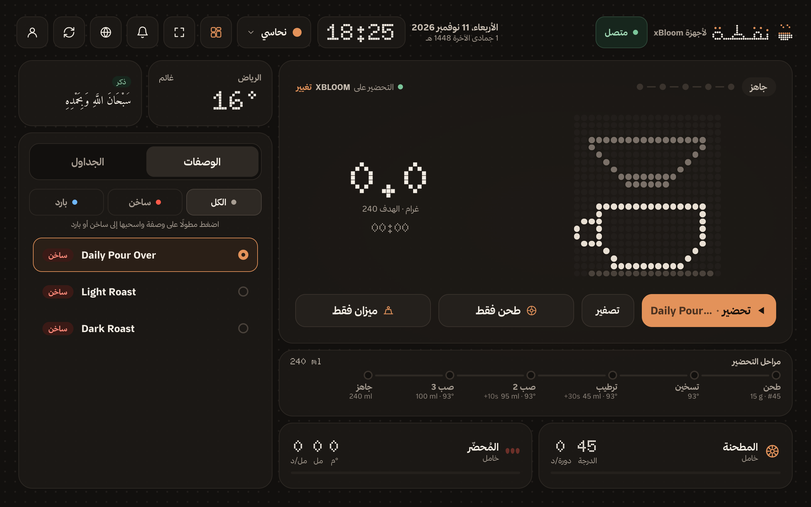

<p align="center">
  
  &nbsp;
  
</p>

<h1 align="center">نُقطة · Nuqta</h1>
<p align="center"><b>A dot‑matrix dashboard that controls your xBloom coffee machine from your Mac</b><br>
Arabic first · tablet, iPad, phone and desktop · themes · Saudi standby scenes · runs entirely at home</p>

---

Nuqta turns a spare tablet, phone or screen into a beautiful controller for an **xBloom** coffee
machine. Your Mac talks to the machine over Bluetooth and serves a live dashboard to every screen on
your home Wi‑Fi. No cloud, no account, no subscription for the base version — it all runs on your own
machine.

> Unofficial and not affiliated with xBloom. It uses a reverse‑engineered Bluetooth interface that
> may change at any time.

## What it does
- **One‑tap brew** of any recipe, with pause, resume and stop.
- **Live dot‑matrix animation** for every stage — grinding, heating, each pour, the cup filling.
- **Brew timeline** showing each step's amount, temperature and wait.
- **Modes:** grind only, water only (temperature · amount · pour pattern), and scale only.
- **Water tank** card that tracks the level and warns when it's low.
- **Recipes & schedules:** wake up to a fresh cup; hot/cold filters.
- **Customisable home:** add, resize and arrange components per device.
- **Themes** that recolour the whole interface and every animation.
- **Standby** scenes after a minute idle.
- **Arabic and English**, with the Gregorian and Hijri dates.
- **Alexa (optional):** "Alexa, turn on coffee" to brew.

<p align="center"></p>

## Install

You need a **Mac** (for the Bluetooth link), **Python 3.10+** and **Node.js 18+**.

### The easy way — with Claude Code
Open this folder in [Claude Code](https://claude.com/claude-code) and say:

> **Set up Nuqta for my xBloom and run it.**

Claude reads `CLAUDE.md` and walks you through every step. That's the whole setup.

### The manual way
```bash
pip3 install bleak aiohttp certifi fauxmo
```
```bash
cd frontend && npm install && npm run build && cd ..
```
```bash
open -a Terminal start-nuqta.command
```
The first run asks macOS for Bluetooth permission — click **Allow**. The Terminal window prints the
addresses to open. On the Mac open **http://localhost:8420**; on a phone or tablet on the same Wi‑Fi,
open the **http://<your‑Mac‑IP>:8420** address it prints. Turn the machine on; it connects by itself.

## Sync your own recipes (optional)
Copy `xbloom_config.example.json` to `xbloom_config.json` and add your xBloom email and password to
pull your recipes. The file stays on your Mac (it's git‑ignored). Without it, a few starter recipes
are built in and the machine is still fully controllable.

## Fonts
The UI prefers the **Thmanyah** font but ships without it (it's licensed), falling back to IBM Plex
Sans Arabic. To use Thmanyah, drop its `.woff2`/`.otf` files in a `fonts/` folder.

## Nuqta Pro
This is the free, open base. **Nuqta Pro** adds brew analytics, phone push notifications, multi‑device
cloud sync, secure remote access and automatic updates, on a subscription. (Details and sign‑up: TBA.)

## License
MIT — see [LICENSE](LICENSE). Not affiliated with xBloom.
